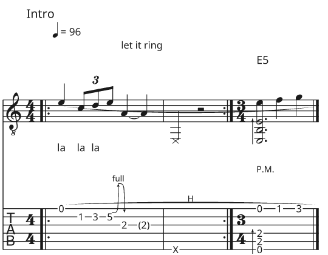

# oxiguitar-tuxguitar

The TuxGuitar plugin for [OxiGuitar](https://github.com/mateusrdp/oxiguitar), a free, open-source guitar tablature and score viewer, editor and player for Windows, macOS and Linux. With it OxiGuitar opens the songs of [TuxGuitar](https://github.com/helge17/tuxguitar), the free tablature editor, and saves songs TuxGuitar opens.

| Plugin file | Id | Reads | Writes |
| --- | --- | --- | --- |
| `tuxguitar.oxp` | `oxiguitar.tuxguitar` | TuxGuitar 2 files (.tg) | TuxGuitar 2 files (.tg) |

**Opening.** Everything TuxGuitar 2 keeps comes along: the song's details, every track with its strings, capo, colour and sound, time and key signatures, tempo, repeats and alternate endings, markers, triplet feel, line breaks, lyrics, chord diagrams and texts, both voices, strums and pick strokes, and every note effect (bends, the tremolo bar, slides, hammer-ons, vibrato, dead and ghost notes, accents, palm mutes, staccato, let ring, harmonics, grace notes, trills, tremolo picking, tapping, slapping and popping, fade-in, dynamics). What OxiGuitar has no place for is named in the import log: a channel's chorus, reverb, phaser and tremolo levels, the settings of TuxGuitar's sound plugins, and stem directions.

**Saving.** A song is saved as TuxGuitar 2 writes it, so TuxGuitar 2.0 and later open it. OxiGuitar tells you first what a TuxGuitar file can't hold: voices past the second, a second staff, the notation marks Guitar Pro 8 has and TuxGuitar doesn't (slurs, hairpins, ottava lines, fermatas, pedal marks, ornaments, rasgueados, golpes, barres, beaming), signs and jumps (segno, coda, da capo), tempo changes inside a bar, and fingerings.

**TuxGuitar 1.** The older binary `.tg` of TuxGuitar 0.7 to 1.5 is not read. TuxGuitar 2 opens those files and saves them in its newer form, which OxiGuitar then reads. TuxGuitar 1.x (Debian still ships 1.6) can't open what this plugin writes.



The picture is [`fixtures/oxiguitar-test.tg`](fixtures/oxiguitar-test.tg) opened in OxiGuitar: OxiGuitar's own test song saved by this plugin and read back.

The file type is decided from the file's contents, never from its extension: OxiGuitar recognises a TuxGuitar 2 file as a ZIP archive holding `version.txt`. It needs OxiGuitar 0.18 or later (plugin interface 1.7).

[docs/design.md](docs/design.md) says what is read and written and what is left out, and why.

## Install

Every [release](https://github.com/mateusrdp/oxiguitar-tuxguitar/releases) holds a zip per system (Linux x86_64 and ARM64, Windows x86_64 and ARM64, macOS), a `.deb` and an `.rpm` for Linux, a per-user installer for Windows (no administrator needed), a `.pkg` for macOS, and a `SHA256SUMS` file. The OxiGuitar manual's [install page](https://mateusrdp.github.io/oxiguitar/installing.html) says which one to use and how to keep plugins updated through your package manager.

You can also copy `tuxguitar.oxp` from a zip into OxiGuitar's plugin folder by hand ([Settings and plugins](https://mateusrdp.github.io/oxiguitar/plugins.html)).

Found a file it reads wrongly? Please [open an issue](https://github.com/mateusrdp/oxiguitar-tuxguitar/issues/new) with the file if you can share it.

## Build and test

Rust 1.99 or later from [rustup](https://rustup.rs). The plugin SDK and the score model come from OxiGuitar's repository by git (plugin interface 1.7); nothing of OxiGuitar's is on crates.io. No Rust library reads TuxGuitar's files, so the format is our own code, ported from TuxGuitar's (LGPL-2.1), on the [roxmltree](https://crates.io/crates/roxmltree), [quick-xml](https://crates.io/crates/quick-xml) and [zip](https://crates.io/crates/zip) crates.

```sh
cargo test                  # the reader, the writer, and the plugin as an .oxp file
./build-oxp.sh              # dist/tuxguitar-VERSION-SYSTEM-ARCH.oxp
```

`cargo test` reads TuxGuitar's own test files and checks them against what TuxGuitar's tests say they hold, writes what it read and reads it back, checks what it writes against TuxGuitar's schema of the format (where `xmllint` is installed), then builds the plugin as the `.oxp` file we ship and checks it through OxiGuitar's own plugin host (the contract suite of `oxiguitar-plugin-test`). With TuxGuitar files of a private collection in `corpus/files/` (never committed), `cargo test --test corpus` round-trips each of them. [CONTRIBUTING.md](CONTRIBUTING.md) has the rest of the rules.

What is where:

- `src/read.rs`: a TuxGuitar 2 file's `content.xml` into OxiGuitar's score. `src/write.rs`: OxiGuitar's score into `content.xml`.
- `src/container.rs`: the ZIP and its `version.txt`. `src/tg.rs`: the format's numbers (its unit of time, velocities, harmonics). `src/spell.rs`: TuxGuitar's "alternative enharmonic" spellings.
- `fixtures/`: our own TuxGuitar file; `fixtures/tuxguitar/`: TuxGuitar's test files and schema, under the LGPL (their [NOTICE](fixtures/tuxguitar/NOTICE)).
- `fuzz/`: fuzz targets for the reader and the writer ([fuzz/README.md](fuzz/README.md)).

## Releases

The maintainer releases with the Release button in [oxiguitar-packages](https://github.com/mateusrdp/oxiguitar-packages): it bumps the version, merges `develop` into `main` and tags it. [`release.yml`](.github/workflows/release.yml) then builds the plugin for every system with the packages' reusable plugin-release workflow, makes the packages and a draft release; publishing the draft starts [`publish.yml`](.github/workflows/publish.yml), which tells the package repositories. Every pull request gets the same builds as test builds, kept for 14 days under its Release run.

## Licence

GPL-3.0-or-later. See LICENSE. The code ported from TuxGuitar was LGPL-2.1, which allows its use under the GPL; the files in `fixtures/tuxguitar/` stay under the LGPL-2.1.
Contributions are welcome under the same terms; see
[CONTRIBUTING.md](CONTRIBUTING.md).
