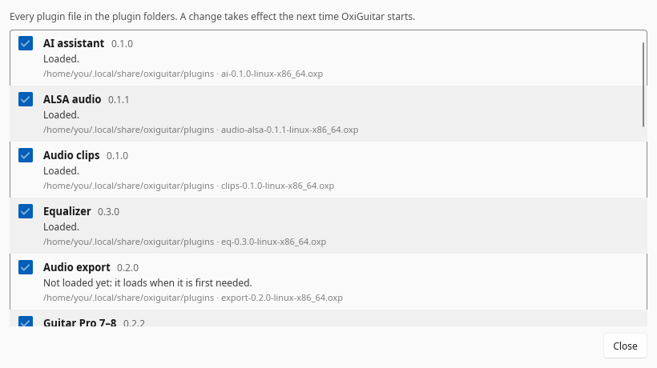

# How to use it

## Check it is installed

**Tools → Plugins…** lists every plugin OxiGuitar found, with its version, and lets you switch any of them off:

## Open and save

- **Open**: **File → Open…** and pick a `.tg` file, or double-click one if your system links the file type to OxiGuitar. OxiGuitar looks inside the file to decide which plugin reads it; the extension doesn't matter.
- **Save**: **File → Save As…** and pick TuxGuitar (`.tg`) as the format. If the format can't hold everything in your score, OxiGuitar says what would be lost before it saves, and you can keep the rest in the `.oxg` file beside it.
- **The import log**: anything the TuxGuitar plugin couldn't bring across is listed in the footer at the bottom of the window when the file opens.

## What you can do with it

- Open a TuxGuitar song. Tracks, tunings, repeats, endings, lyrics, chord diagrams, both voices and the note effects all come along. What OxiGuitar has no place for is listed in the import log.
- Move a song from OxiGuitar to TuxGuitar 2 and back.
- Keep working with a collection you started in TuxGuitar.

The older binary `.tg` format of TuxGuitar 0.7 to 1.5 is not read. Open such a file in TuxGuitar 2, save it there, and OxiGuitar can read the result. TuxGuitar 1.x can't open what this plugin writes.

OxiGuitar tells you before saving what a TuxGuitar file can't hold, such as voices past the second, slurs, hairpins, segno and coda signs, and fingerings.
